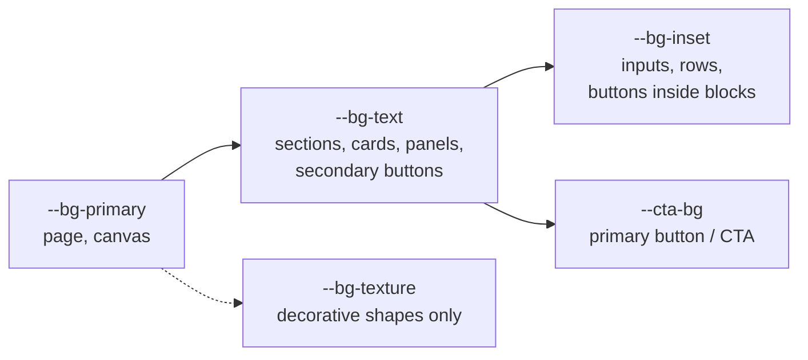

# Cloud Scythe Labs — Design Language

Working specification of the Cloud Scythe Labs (CSL), ReaCloud and Altair visual language for designers and front-end developers.
It consolidates `CSL_Brand_Guidelines_V1.0.2.pdf`, the `!Quick_*_Guide.rtf` files, `Color_Palettes.rtf`, the shipped assets, the designer's presentations (V1–V5) and newer landing page, and the live site (`reacloud/site`), and fills the gaps the PDF marks WIP/TBA.

Tokens: [`csl-tokens.css`](csl-tokens.css) — every value below exists there; components must read role tokens, never hex values.
Review mockups: [`01_Test_Zone/01_5_Mockups/`](../../01_Test_Zone/01_5_Mockups/index.html).
**Proposed direction under review:** [`Nocturne_Direction.md`](Nocturne_Direction.md) — replaces the color, surface, status and layout rules (§2, §5) if accepted.

Status markers:

| Marker | Meaning |
|---|---|
| **[GUIDELINE]** | Stated in Brand Guidelines v1.0.2 or the quick guides. Change only with the brand designer. |
| **[DESIGNER]** | From the designer's presentations or landing page, not restated in the PDF. Rationale, not yet rule. |
| **[DECIDED]** | Decided by Cloud Scythe Labs during this review; supersedes the PDF where they differ. |
| **[PROPOSED]** | New in this document to fill a gap. Needs sign-off before it counts as rule. |
| **[OPEN]** | Decision required; options listed in [Open decisions](#11-open-decisions). |

---

## 0. Lineage

How the language got here. Later sources win unless marked otherwise. Dates come from file metadata and git history; undated presentations are ordered by their cross-references.

| When | Source | What it settled | What it dropped |
|---|---|---|---|
| before May 2025 | Presentation V1 (`funny-squircle-853478.framer.app/v1`) | Pixel type on a 5×7 grid (then called "Reaper"); Display vs Monospace split; zero-for-O with a diagonal at the lightning-bolt angle; curves only on the upper half of letters, softened inside corners; rounded frames/buttons; pure black + Faded White; B&W photography direction | Storm-cloud + lightning emblem; Helvetica Neue body; Middle Grey `#545454`; 80% opacity paragraphs; "Cut through the clouds" tagline |
| before May 2025 | Presentation V2 (`/v2`) | Full character set incl. lowercase (for the terminal); rounded outer corners on all type; zero stylisation confirmed (diagonal) | Three-circle cloud emblem (later became the ReaCloud emblem) |
| May 2025 | V3 (Drive) | Emblem candidates 2, 5, 6, 12, X1–X5 (dark/light) | — |
| after May 2025 | Presentation V4 (`/v4`) | Terminal on a 5×8 grid (x-height 5.5) with Berkeley Mono / JetBrains Mono references, discretionary alternates and coding ligatures; Display stays 5×7; square-framed scythe emblem; distortion effect rules; first accent hues (VHS / cassette inspiration) | — |
| before Oct 2025 | V5-motion (`/v5-motion`) | Website mock; Duo2 ring color-cycle motion; dark/light-context accent sets; theme switcher | Four-theme switcher (dark, dark-gray, gray, light) → three themes |
| Oct 2025 | Brand Guidelines v1.0.2 (PDF) | PS2/PS1/PS5 themes and roles; text only `#000`/`#E6E6E6`; text backgrounds; radius 10; no strokes; Roboto Mono body | — |
| Nov 2025 | Font commits | Branding fonts V5.5 (Display, Mono, Dot Display, Dot Mono), Terminal V11 | — |
| by May 2026 | Designer landing (`great-experience-522230.framer.app/landing`) → live site (`reacloud/site`, styled May 2026) | Site structure: nav, ticker hero, product cards with action rows, Dot Display footer wordmark, "ALL SYSTEMS ONLINE"; JetBrains Mono body | Deviates from the PDF: `#1C1C1C` panels, 6px radius, hairline borders, gray muted text (see [§12](#12-live-site-audit)) |
| Oct 2026 | This review | JetBrains Mono body [DECIDED]; all three themes on the web [DECIDED]; surfaces [OPEN-10] | Roboto Mono |

## 1. Principles

1. **Monochrome first, color with meaning.** Interfaces are built from four neutrals per theme. Color is reserved for status and the Duo emblem ring. [GUIDELINE]
2. **Legibility over decoration.** Text is only ever Pure Black `#000000` or Faded White `#E6E6E6`, and sits on a text background. [GUIDELINE]
3. **Pixel-grid precision, soft containers.** Hard, grid-built pixel type is paired with un-outlined, rounded blocks (radius under review, OPEN-10). [GUIDELINE]
4. **Clean, no effects.** No glows, drop shadows, gradients on brand elements, outlines/strokes on blocks, stretching or warping. [GUIDELINE]
5. **Generous negative space, tight groups.** Related elements sit close; unrelated elements far apart. Negative space reads premium; tight spacing reads technical. [GUIDELINE]
6. **Short copy.** Titles on one line where possible; paragraphs ≤ 3 lines (4 at a push). [GUIDELINE]
7. **Forward is right.** Progressing actions (confirm, save, purchase, next) sit on the right. [GUIDELINE]

## 2. Color

### 2.1 Neutrals

| Token | Hex | Name | Role |
|---|---|---|---|
| `--csl-pure-black` | `#000000` | Pure Black | PS2 primary bg · text/graphics on light · CTA text |
| `--csl-dark-accent` | `#0A0A0A` | Dark Accent | PS2 texture (decorative) |
| `--csl-faded-black` | `#141414` | Faded Black | PS2/PS1 text background · PS5 CTA |
| `--csl-gray-accent` | `#7D7D7D` | Gray Accent | PS1 texture (decorative) |
| `--csl-ps1-gray` | `#878787` | PS1 Gray | PS1 primary bg · Duo2 idle |
| `--csl-light-gray` | `#ADADAD` | Light Gray | PS5 primary bg |
| `--csl-light-accent` | `#BBBBBB` | Light Accent | PS5 texture (decorative) |
| `--csl-faded-white` | `#E6E6E6` | Faded White | text/graphics on dark · PS5 text background · dark CTA |

### 2.2 Themes

Three themes, named after console generations. PS2 and PS1 are **dark context**; PS5 is **light context**. Context selects the extended-color set (§2.3), not brightness. [GUIDELINE]

| Role token | Use | PS2 "Dark" | PS1 "Gray" | PS5 "Light" |
|---|---|---|---|---|
| `--bg-primary` | Page/canvas, backdrops, garments | `#000000` | `#878787` | `#ADADAD` |
| `--bg-text` | Sections, frames, text backgrounds, secondary buttons | `#141414` | `#141414` | `#E6E6E6` |
| `--bg-texture` | Background shapes, subdued emblems — decorative only | `#0A0A0A` | `#7D7D7D` | `#BBBBBB` |
| `--fg` | Text, icons, graphics, logotypes, emblems, Duo1 | `#E6E6E6` | `#E6E6E6` | `#000000` |
| `--cta-bg` | Primary buttons / CTAs | `#E6E6E6` | `#E6E6E6` | `#141414` |
| `--cta-fg` | Text on primary buttons | `#000000` | `#000000` | `#E6E6E6` |
| `--duo2-idle` | Duo2 ring when no status applies | `#878787` | `#878787` | `#878787` |
| `--bg-inset` | Surfaces nested inside `--bg-text`: inputs, table rows, secondary buttons on a block [PROPOSED] | `#000000` | `#000000` | `#ADADAD` |
| `--fg-on-primary` | Brand text/marks placed directly on `--bg-primary` (hero title, mono emblem, tickers) [PROPOSED] | `#E6E6E6` | `#000000` | `#000000` |

Apply a theme with `data-theme="ps2|ps1|ps5"` on `<html>` or any container; PS2 is the default. All three themes apply to the website and product UI, not only print/social/video. [DECIDED]

### 2.3 Extended colors

Dark-context colors are lighter/less saturated; light-context colors darker/more saturated. [GUIDELINE]

| Hue | Dark context (PS2, PS1) | Light context (PS5) |
|---|---|---|
| Red | `#EF4B46` | `#E03631` |
| Orange | `#F5863D` | `#EA642D` |
| Yellow | `#F4E854` | `#D3C439` |
| Green | `#0ED6A2` | `#0FBD7D` |
| Blue | `#63A7E8` | `#4784D8` |
| Purple | `#BE63E3` | `#A046D2` |
| Pink | `#EA78C8` | `#D956AD` |

Use the context-aware tokens `--red` … `--pink`; they switch with the theme.

### 2.4 Color logic

| Token | Hue | Meaning | Examples | Status |
|---|---|---|---|---|
| `--status-success` | Green | Positive / success | Completed upload, submission, correct password, discount | [GUIDELINE] |
| `--status-neutral` | Blue | Neutral / passive | Connected, idle, working as usual | [GUIDELINE] |
| `--status-caution` | Yellow | Caution / low priority | Slow connection, upload paused | [GUIDELINE] |
| `--status-warning` | Orange | Warning / high priority, resolvable | Incorrect password, recoverable issue | [GUIDELINE] |
| `--status-critical` | Red | Error / critical | Failures, unresolvable errors, destructive actions | [GUIDELINE] |
| `--status-progress` | Purple | In progress | Syncing, rendering, processing | [PROPOSED] — v1.0.2 says "undefined, in-progress?" |
| `--status-notify` | Pink | Notification | Unread, mentions, new activity | [PROPOSED] — v1.0.2 says "undefined, notifications?" |
| `--status-idle` | PS1 Gray | Idle / offline / no state | Offline collaborator, unused slot; same gray as Duo2 idle | [PROPOSED] |

Rules:

- Never rely on hue alone: every status color is paired with a text label or glyph (color-blind users; see contrast in §2.5). [GUIDELINE: colors are "labelled and named"]
- Text placed on a color fill is Pure Black (`--on-status`). [GUIDELINE]
- Color may be used for a CTA only when the CTA itself carries the status (e.g. red destructive confirm). [GUIDELINE: "in certain circumstances"]

### 2.5 Contrast (WCAG 2.x, computed)

| Pair | Ratio | Verdict |
|---|---|---|
| Faded White on Pure Black (PS2 text) | 16.83 | AAA |
| Faded White on Faded Black (PS2/PS1 text bg) | 14.76 | AAA |
| Pure Black on Faded White (PS5 text bg) | 16.83 | AAA |
| Faded White on PS1 Gray | 2.88 | **Fail** — why PS1 text must sit on `--bg-text` |
| Pure Black on PS1 Gray | 5.85 | AA (used by the PS1 ticker) |
| Pure Black on Light Gray (PS5 primary) | 9.36 | AAA |
| Texture on primary (all themes) | 1.06–1.17 | Decorative only, by design |
| `--bg-inset` on `--bg-text`: input/checkbox fill vs its block (PS2/PS1 `#000` on `#141414`; PS5 `#ADADAD` on `#E6E6E6`) | 1.14 / 1.80 | **Fail** for form-control boundaries (WCAG 1.4.11 needs 3:1) — see OPEN-13 |
| Duo2 idle `#878787` on Faded Black | 5.13 | ≥ 3:1 non-text |
| Duo2 idle `#878787` on Faded White (PS5) | 2.88 | **< 3:1** — acceptable only because idle Duo2 is decorative |
| Dark-context colors on Faded Black | 5.06 (red) – 14.49 (yellow) | All ≥ 4.5 |
| Dark-context colors on PS1 Gray | 1.01 – 2.83 | **Fail** — status color never on PS1 primary |
| Light-context colors on Faded White (PS5 text bg) | 1.44 (yellow) – 3.91 (purple) | **Only red, blue, purple ≥ 3:1** |
| Pure Black text on light-context colors | 4.30 (purple) – 11.72 (yellow) | All ≥ 3:1; purple < 4.5 for small text |

Consequence: in PS5, yellow/green/orange/pink status marks are under the 3:1 non-text minimum against `--bg-text`. Use them as **fills carrying black text** (≥ 4.3:1), not as thin marks or colored text. [PROPOSED] See [OPEN-3](#11-open-decisions).

### 2.6 Color rules

- Text and non-decorative graphics: `--fg` only (Pure Black or Faded White). Never gray text. [GUIDELINE]
- Text sits on `--bg-text`, not `--bg-primary`. Exceptions: primary buttons, CTAs, branding elements, and a one-line Display hero title. Anything placed directly on a primary background uses `--fg-on-primary` and the mono emblem — in PS1 that is Pure Black (5.85:1), matching the PS1 ticker, because Faded White on PS1 Gray is 2.88:1. [GUIDELINE: "as much color contrast as possible"; PROPOSED token]
- Decorative textures (emblem silhouettes) may crop at container edges, as on the v1.0.2 section opener pages. [GUIDELINE by example]
- `--bg-texture` never carries text, information or interactive elements. [GUIDELINE]
- Only the Duo2 element of the emblem may be recolored, and only with brand colors. Logotypes, text and Duo1 are never recolored. [GUIDELINE]

## 3. Typography

### 3.1 Families

| Family | File | Role | Status |
|---|---|---|---|
| **CSL Display** | `01_Branding/CSL_Display.{otf,woff2}` | Large titles that fit on **one line**. Proportional; breaks the monospace rhythm when wrapped. | [GUIDELINE] |
| **CSL Mono** | `01_Branding/CSL_Mono.{otf,woff2}` | Multi-line titles, headings, buttons, nav, labels. "If in doubt, use Mono." | [GUIDELINE] |
| **CSL Dot Display** | `01_Branding/CSL_Dot_Display.{otf,woff2}` | Dot-matrix alternate of Display. The designer's landing uses it for the large footer wordmark. | [DESIGNER] decorative wordmark; rest [OPEN-1] |
| **CSL Dot Mono** | `01_Branding/CSL_Dot_Mono.{otf,woff2}` | Dot-matrix alternate of Mono. Live readouts (fixed-width digits). | [OPEN-1] |
| **JetBrains Mono Regular** | Google Fonts / JetBrains (OFL) | Paragraphs, copy, form input values, footer links, anything small. Sentence case. | [DECIDED] — replaces Roboto Mono from the PDF; the designer's landing already uses it, and CSL Terminal is built on it |
| **CSL Terminal** | `02_Internal/CSL_Terminal*.{ttf,woff2}` | Developer family: code, logs, terminals, CLI samples, license keys. Variable weight 100–800, upright + italic, ~1,750 glyphs, JetBrains Mono's full ligature set. | [DECIDED] — a modified JetBrains Mono (SIL OFL 1.1) with the CSL layer: squarer bowls, pixel-bitten lower corners, square dots, slashed zero. See §3.5. |

Paths are relative to `03_Branding_Assets/03_02_Typefaces/`.

### 3.2 Rules

- Brand fonts (Display, Mono, Dot) are **uppercase only** and only for titles, buttons and labels — never paragraphs or small text. [GUIDELINE]
- CSL Terminal is exempt from the uppercase rule: it renders code, logs and paths verbatim, in mixed case. [PROPOSED]
- Display only for one-line titles; anything that may wrap (including responsive wrapping) uses Mono. [GUIDELINE]
- No letter-spacing, no synthetic bold/italic, no outlines/effects on brand fonts. The fonts ship one weight and spacing is part of the design. [PROPOSED]
- Titles sit close to the paragraph they introduce; groups separated by larger gaps. [GUIDELINE]
- The wordmark spelling "CLØUD" (zero for O) belongs to the logotype artwork only. In running text write **Cloud Scythe Labs** and **ReaCloud**; in brand-font titles write `CLOUD SCYTHE LABS` / `REACLOUD`. Never typeset the logotype — use the SVG. [PROPOSED] The large Dot Display "CLOUD SCYTHE LABS" footer line from the designer's landing counts as a decorative title, not the logo: plain O, never paired with the emblem as a lockup. [DESIGNER, PROPOSED reading]
- Underscore for space (`CL0UD_REAPER`, `CUT_THR0UGH_THE_CL0UDS`) is a designer device for product codes and decorative titles only — never in running text, buttons or navigation. [DESIGNER]

### 3.2a Letterform DNA [DESIGNER]

The rules any new glyph must follow (from presentations V1, V2, V4):

- **Grids.** Branding fonts: 5×7 pixel grid (V4: 5×8 tested and rejected for branding — "weaker", loses the strength of 5×7). Terminal v1 used a 5×8 grid; Terminal v2 drops the grid for JetBrains Mono's outlines (see §3.5).
- **Curves only where they carry the shape**, on the upper half of letters (C, O, U); the lower half stays pixel-stepped. Fewer curves make the remaining ones feel more deliberate.
- **Softened inside corners** so pixels appear to bleed together; small rounding on outer corners to echo the emblem.
- **Zero for O** in the wordmark: an O with a diagonal bar, angled like the original lightning bolt. The diagonal won over dot, slash-through and bar variants (V2).
- **Display vs Mono:** Display fixes over-wide letters such as L in large one-line titles; Mono keeps stacked lines aligned.
- **Terminal references:** Berkeley Mono, JetBrains Mono, PP Display Mono — distinct similar shapes (0/O, 1/l/I), centred punctuation. V4's discretionary alternates and coding ligatures are covered by JetBrains Mono's `cv01`–`cv20`, `ss01`–`ss20` and `calt` set in Terminal v2.
- **Lowercase** exists for code and terminal use; brand use stays uppercase (V2).

### 3.3 Pixel grid and crisp sizes

All brand fonts are drawn on a 100-unit pixel grid. Rendering stays crisp when one font pixel maps to a whole number of device pixels:

| Font | UPM | Font pixel | Crisp CSS sizes (1× displays) | Cap height |
|---|---|---|---|---|
| CSL Mono, CSL Dot Mono | 1000 | 0.1 em | 10, 20, 30, 40, 60, 80, 100 px … | 7 px-grid units |
| CSL Display, CSL Dot Display | 1100 | 1/11 em | 11, 22, 33, 44, 66, 88, 110, 132 px … | 7 px-grid units |
| CSL Terminal | 1000 | — (outline font) | any | cap 730, x-height 550 (JetBrains Mono metrics) |

Because of the UPM difference, Display renders at ~91% of Mono at the same `font-size` (see [OPEN-2](#11-open-decisions)).

### 3.4 Type scale [PROPOSED]

| Token | Size | Family | Use |
|---|---|---|---|
| `--type-hero` | 132px | Display | Hero, one line |
| `--type-display` | 88px | Display | Section openers, one line |
| `--type-display-s` | 44px | Display | Card titles, one line |
| `--type-title-l` | 60px | Mono | Multi-line hero |
| `--type-title` | 40px | Mono | Section titles |
| `--type-title-s` | 30px | Mono | Sub-headings |
| `--type-label` | 20px | Mono | Buttons, nav, chips, eyebrows |
| `--type-body` | 16px / 1.6 | JetBrains Mono | Copy, max `--measure` (70ch) |
| `--type-body-s` | 14px / 1.6 | JetBrains Mono | Captions, helper text |
| `--type-code` | 22px | Terminal | Terminal panes, code blocks |
| `--type-code-s` | 13px | Terminal | Dense logs, status bars |

On narrow viewports step down one size within the same family rather than scaling fluidly; fluid sizes land between crisp sizes.

### 3.5 Typeface status

The four branding fonts are proofs of concept: 195 glyphs each (ASCII, part of Latin-1, arrows), no accented letters, no kerning. The designer's V2/V4 glyph sheets already show more than the files contain — e.g. € and other currency signs, Ω, extra arrows — so completing them means adding those drawings first, then filling accents and symbols. Editable sources and the build live in `03_Branding_Assets/03_02_Typefaces/00_Sources/` (see its README for the full gap list). Completing the character sets follows sign-off of this document, because OPEN-1, OPEN-2 and OPEN-6 change what the fonts must contain.

**CSL Terminal v2** replaces the designer's v1 (archived in `01_Test_Zone/01_1_Typeface/01_1_3_Terminal_Mono/CSL_TERMINAL_1.020.ttf`). Measured against JetBrains Mono, v1 was 9% wider per letter, had a lower x-height (0.50 vs 0.55 em), ascenders shorter than its capitals, a tighter line (1.27 vs 1.32 em) and bracket-like parentheses — a branding face drawn as a terminal face. v2 is JetBrains Mono 2.305 rebuilt by `00_Sources/terminal.py` with a CSL layer applied to every master:

| CSL layer | Setting |
|---|---|
| Proportions and weight | JetBrains Mono's heights, widths and letterforms; strokes start at JetBrains Mono's widths and are trimmed 7% (Regular stems 84, Bold 117) so that, with CSL's even strokes, a paragraph matches JetBrains Mono's weight to the eye. No overshoot: like CSL's pixel fonts, rounds and flats share exact lines (x-height 550, caps 730, baseline 0, descender −180). v1's lower x-height and wider letters were tried and dropped |
| CSL strokes | From the glyph review against CSL Terminal V4 (`01_Test_Zone/01_1_Typeface/01_1_3_Terminal_Mono/glyph_review/`): letters and digits take CSL's even stroke: horizontals as thick as verticals, joins where an arch or bowl meets a stem kept at full width (no JetBrains Mono ink traps), diagonals at stem weight where the counters allow, and squarer curvature (each corner rebuilt as concentric arcs, outer radius 1.5 × the stroke; 2.0 on 6 and 9, whose bowls read pinched at 1.5; 1.0 where the bowls of 8 and B meet, so the notch at the waist stays shallow). Counter corners have the same inner radius (half a stroke, one stroke on 6 and 9), including the waist corners of 8 and B and the corner of R's bowl above the leg, as in V4; where 6 and 9's stroke meets the bowl, the counter corner is just round enough that the stroke keeps its width there. b d p q r m h n keep JetBrains Mono's curves on their free corners; symbols keep them 60% squarer until their own pass |
| Knee bends | On the letters CSL V4 draws with knees (v V w W X y Y k K A), plus R's leg to match A's, a diagonal stroke that ends on the baseline, x-height or cap height turns vertical for its last stroke width, so the end is a square, as in V4. The vertical ends span no wider than T's bar, as V4's letters all span one width, so they don't crowd a neighbouring T or I; the stroke keeps one width all along the diagonal and round the elbow. w and W keep JetBrains Mono's width and draw all four strokes at one slightly lighter weight (0.85 stems) so their counters stay open. Lowercase x, the digits and y's tail keep straight diagonals; the point where two strokes meet (foot of v, V, W) stays a point. Where two diagonals meet in a crotch (x, X, y, Y, v, w, W, A), and where the diagonal of 6 and 9 meets the bowl, they meet in a clean sharp corner, without JetBrains Mono's ink-trap notch |
| Glyph ports | 8 with equal counters, Q as O with a vertical tail down the centre, R's leg starting further right under the bowl, ? and ¿ in CSL V4's shape (JetBrains Mono's width, stroke and dot), 0 with CSL Mono's stroke-thick slash through the centre. The italic keeps the double-storey a of the upright (JetBrains Mono's italic switches to a single-storey a) |
| v1 chunks | Rolled out a glyph at a time as approved. CSL Terminal v1 is an existing font with square chunks cut out in FontForge: each chunk is the square where a vertical and a horizontal stroke overlap at an outer corner, with the inner corner beside it rounded, so the strokes touch only through a thin diagonal neck (the "ghost" gap). v2 cuts the same squares: both bottom corners of 0 o s u O G U S, the bottom-left of c e C, the bottom-right of J D, all with the same half-stroke rounding (i, j, l, a and 8 were tried and dropped). Bold and Bold Italic have no chunks for now; in the variable font they shrink away towards ExtraBold. The slash of the slashed 0 stays clear of the counter's corners, so in the heavy weights it runs flatter. v1's bar 0 and a 0 with a free-standing centre line were tried as alternates and dropped for the slashed 0 |
| Square dots | Every round dot (i j . : ; ! ? … ·) becomes a square, 6% smaller for equal weight; rings (å, °) stay round |
| Slashed zero | Default; the `zero` feature switches to JetBrains Mono's dotted zero |

License: CSL Terminal is distributed under the SIL OFL 1.1 (as required for a JetBrains Mono derivative). It can ship with products and be embedded freely; it cannot be sold on its own, and `OFL.txt` must travel with the font files.

## 4. Brand marks

### 4.1 Inventory

| Mark | Variants | Location |
|---|---|---|
| CSL emblem — Mono | `Square` / `Rectangle` × `Padding` / `NoPadding` | `03_Branding_Assets/03_03_Emblem/03_03_01_Mono/` |
| CSL emblem — Duo | as above × `Duo1` (blade), `Duo2` (ring), `DuoCombo` (both, groups `DUO1`/`DUO2`) | `03_Branding_Assets/03_03_Emblem/03_03_02_Duo/` |
| CSL logotype | `Logotype1` two-line + superscript LABS · `Logotype2` one line · `Logotype3` three-line, LABS beneath | `03_Branding_Assets/03_04_Logotype/` |
| CSL lockup — Mono / Duo | `Lockup1` emblem + two-line logotype · `Lockup2` emblem + one-line logotype | `03_Branding_Assets/03_05_Lockups/` |
| ReaCloud emblem | `Square` / `Rectangle` × padding | `04_Product_Assets/04_01_ReaCloud/04_01_01_Emblem/` |
| ReaCloud logotype | `Logotype1` REA / CLØUD stacked · `Logotype2` one line | `04_Product_Assets/04_01_ReaCloud/04_01_02_Logotype/` |
| ReaCloud lockup | `Lockup1` stacked · `Lockup2` one line | `04_Product_Assets/04_01_ReaCloud/04_01_03_Lockups/` |

File naming: `CanvasShape_PaddingType_ColorType` (emblems), `LogotypeType_PaddingType`, `LockupLayout_PaddingType_ColorType`. [GUIDELINE]
SVGs carry no fill; set `fill` (or `color` + `fill="currentColor"` when inlined) from `--fg` / Duo2 tokens.

### 4.2 Rules

- **Color:** marks are `--fg` only (Pure Black or Faded White). Only Duo2 takes color. [GUIDELINE]
- **Duo z-order:** Duo1 (blade) always above Duo2 (ring). Stacked Duo1/Duo2 files align when canvas shape and padding type match. [GUIDELINE]
- **Duo placement:** Duo marks sit on `--bg-text`, never `--bg-primary` (Duo2 vanishes on PS1 gray). On a primary background use the Mono emblem. [GUIDELINE]
- **Duo2 states:** idle `--duo2-idle` (`#878787`); otherwise a status token from §2.4 to show status or tone. [GUIDELINE + PROPOSED mapping]
- **Centre point:** in every emblem file, padded or not, the ring's circle is the centre of the canvas. Align to containers by the file centre. [GUIDELINE]
- **Scale pairing:** text set beside an emblem is roughly the height of the emblem's circle (~60% of emblem height), never equal to the emblem height. Prefer the shipped lockups over manual pairing. [GUIDELINE]
- **Safezone:** the padded files' padding is the safezone — optically balanced, not symmetrical. Nothing enters it. Use `NoPadding` only when the layout supplies equivalent space. [GUIDELINE]
- Never stretch, warp, rotate, outline, add effects, or rebuild marks from fonts. [GUIDELINE] Single exception: the designer's animated emblem distortion in hero, promo and loading motion (§6) — never in static use. [DESIGNER]

### 4.3 ReaCloud

ReaCloud is a CSL product brand. It shares palette, themes, type and layout rules; only the emblem/logotype change. ReaCloud has no Duo variant: its emblem is Mono-only and follows the Mono rules. [GUIDELINE: ReaCloud quick guide]

## 5. Layout and components

### 5.1 Surfaces

Surfaces layer by fill, not elevation; there is no shadow system. Primary → text background → inset or CTA. [GUIDELINE for primary/text/CTA; PROPOSED for inset]



- Blocks: `--radius` corners, filled with `--bg-text`. [GUIDELINE: 10px, no border — under review, see below]
- Nested surfaces inside a text background: `--bg-inset` fill, `--radius-s`. Never `--bg-primary`: in PS1 that puts Faded White on PS1 Gray (2.88:1). [PROPOSED]
- Separation comes from fill and space, never from shadows. [GUIDELINE]

**Under review [OPEN-10].** The PDF and the designer's newer landing (and the live site) disagree, and neither is final. The mockups' review bar switches each axis independently (`PANEL`, `RADIUS`, `EDGE`, also via `?panel=&radius=&edge=`):

| Axis | PDF v1.0.2 | Landing / live site |
|---|---|---|
| Text-background color (dark themes) | `#141414` Faded Black | `#1C1C1C` (not in the palette) |
| Corner radius (blocks / nested) | 10px / 5px | 6px / 3px |
| Edges | none — "no outlines or border strokes" | 1px hairline, `--fg` at 10% |
| Muted text | not allowed — `#000`/`#E6E6E6` only | `#ADADAD` for secondary text: 9.36:1 on black, but 1.80:1 on Faded White, so it cannot carry over to PS5 |

### 5.2 Spacing [PROPOSED]

10px base unit, matching the font pixel grid: `--space-1` 5 · `--space-2` 10 · `--space-3` 20 · `--space-4` 30 · `--space-5` 40 · `--space-6` 60 · `--space-7` 80 · `--space-8` 120 (px).

- Inside a block: padding `--space-3`–`--space-4`; title → paragraph `--space-2`.
- Between related blocks: `--space-3`. Between sections: `--space-6`–`--space-8`.
- One spacing value per relationship across a screen (consistency rule). [GUIDELINE]

### 5.3 Buttons

| Type | Fill | Text | Font | Placement |
|---|---|---|---|---|
| Primary / CTA | `--cta-bg` | `--cta-fg` | CSL Mono, `--type-label`, uppercase | Rightmost in its group [GUIDELINE] |
| Secondary (cancel, back, other) | `--bg-text` (on primary bg) | `--fg` | same | Left of the primary |
| Destructive confirm | `--status-critical` | `--on-status` | same | Rightmost, replaces primary [PROPOSED] |

Buttons: `--radius`, no border, padding `--space-2` × `--space-3`. One primary per view region. [PROPOSED sizing]
When a secondary button sits on `--bg-text`, it uses `--bg-inset`; on `--bg-inset`, it uses `--bg-text`. It always takes the neighbouring surface step so it stays visible. [PROPOSED]
When buttons must stack (narrow screens), stack in reading order with the primary last, each full width. [PROPOSED]

### 5.4 Status indicators [PROPOSED]

- **Chip:** status-color fill, black CSL Mono label, `--radius-s`. Works in every theme (§2.5).
- **Dot + label:** small status-color square (one font pixel scale) + `--fg` label. Dark contexts only; in PS5 use chips.
- **Duo emblem ring:** Duo2 set to status color for app-level state (e.g. connection).

### 5.5 Focus and interaction [PROPOSED]

The no-outline rule applies to static blocks. Keyboard focus still needs a visible indicator (WCAG 2.4.7): 2px `--fg` outline, 2px offset, following `--radius`. Hover: button labels get a 2px underline (one font pixel at `--type-label`); fills and colors do not change, so hierarchy and contrast stay fixed. Transitions: `--duration` with `--ease`; no bounce.

### 5.6 Content width and alignment [PROPOSED]

Body copy max `--measure` (70ch). Left-aligned text; centered text only for single-line titles and empty states. Forward actions right-aligned.

## 6. Motion

**Tickers** [GUIDELINE: shipped assets] — `03_Branding_Assets/03_06_Tickers/`: alternating rows of `CLØUD SCYTHE LABS` and `LIVE IN THE DAW` in CSL type, rotated ≈30°, scrolling; 5.67s clips at 60fps. The live site and the designer's landing also run them as a large blurred-edge band across the hero. Variants by theme and resolution:

| Variant | Background | Text (sampled from renders) |
|---|---|---|
| `PS2` | Pure Black | Faded White (renders `#E1E1E1`) |
| `PS1` | PS1 Gray (renders `#7B7B7B`) | Faded Black (renders `#131313`) |
| `PS1inv` | Faded Black | PS1 Gray (renders `#7B7B7B`) |
| `PS5` | Faded White (renders `#E1E1E1`) | Pure Black |

Formats: `1080p/`, `4K/`, `Vertical/`; `.mov` masters and `_Compressed.mp4` for web; `4k_PS2.gif`.
Use tickers as full-bleed backgrounds or section dividers behind no text, or behind text only inside a `--bg-text` block. [PROPOSED]
Note: the PS1 render shows `#7B7B7B` instead of `#878787` (video encoding shift) — see [Errata](#10-errata-in-v102).

Respect `prefers-reduced-motion`: replace tickers with a still frame. [PROPOSED]
Mockup tickers are a CSS rendition (`.ticker` in the mockups) using `--fg-on-primary` on `--bg-primary`. The shipped PS5 render uses Faded White as its background instead of Light Gray. [OPEN-9]
Ticker speed should be specified as distance per second, not loop length: with a fixed `--ticker-cycle`, longer rows or larger type scroll faster (the mockup's 120px rows run ≈600px/s, much faster than the live site). [PROPOSED: measure the shipped renders and set a px/s token]

**Duo2 color-cycle** [DESIGNER: V5-motion, `Profile_CSL-Black_Color_Shift.gif`] — the Duo emblem holds still while the Duo2 ring steps through red → orange → yellow → green → blue → purple → pink → idle gray. Use for loading, splash and avatar animation. Under reduced motion, hold the idle ring.

**Emblem distortion** [DESIGNER: V4] — wisp/glitch distortion of the emblem for hero sections, promotional video and loading animations, used sparingly. Never at small sizes (favicons), in embroidery/emboss/print, or as a replacement for the clean mark.

**Button micro-interaction** [DESIGNER: V1] — e.g. ADD TO CART: cart glyph sits left; on hover it slides right and becomes `+`; on press it resolves to a check. The V1 version brightened the button to pure white on hover, which the palette no longer allows; keep fills fixed (§5.5) and move only the glyph. [PROPOSED reconciliation]

## 7. Voice cues

- Company tagline: **LIVE IN THE DAW** (tickers, site footer). Earlier placeholders: "Cut through the clouds", "Lightning fast collaboration" (V1) — retired.
- Interface copy is short, uppercase in brand fonts, sentence case in JetBrains Mono. [GUIDELINE for casing; DECIDED for font]
- Product names in running text: **ReaCloud**, **Altair**. ReaCloud was previously "Cloud Reaper" / `CL0UD_REAPER` (V1, V5 mock, `01_2_2-Cloud_Reaper` social folder).

### 7.1 Products

| Product | Line | What it is | Marks |
|---|---|---|---|
| **ReaCloud** | RECORD. COMMIT. PUSH. | Extension plug-in that adds cloud storage and version control to the REAPER DAW, with a desktop daemon and CLI. Subscription: Basic 10 GB, Pro 200 GB, Enterprise custom. | Emblem, logotypes, lockups (§4.3) |
| **Altair** | MASSIVE METAL TONES | Metal guitar library for Native Instruments Kontakt. One-time license. | None yet — type only, never an improvised logo [OPEN-11] |

### 7.2 Photography [DESIGNER: V1]

- Black and white, high contrast; product UI screenshots in grayscale (as on the live site).
- Light or white backdrops for people and merchandise so they stand off the black UI; skin tones may stay warm.
- A healthy amount of film grain in the photo itself; no CSS filters, glows or overlays.
- Frames take `--radius` corners and no border.

## 8. Social assets

`01_Test_Zone/01_2_Social_Assets/`: banners (Dark/Light × Solid/Transparent) and profile images (Black, Dark, Grey, Lighter, plus an animated color-shift GIF) for CSL and `Cloud_Reaper`. These predate the v1.0.2 logotype exports (older letterforms). [OPEN-5]

## 9. Asset map

```
01_Test_Zone/                 experiments, beta fonts, social drafts, mockups for review
02_Brand_Guidelines/          PDF guidelines + this design language + tokens
03_Branding_Assets/
  03_01_Color_Palettes/       Color_Palettes.rtf (palette roles, mirrors csl-tokens.css)
  03_02_Typefaces/            00_Sources (UFO + build), 01_Branding, 02_Internal
  03_03_Emblem/  03_04_Logotype/  03_05_Lockups/  03_06_Tickers/
04_Product_Assets/04_01_ReaCloud/
```

## 10. Errata in v1.0.2

Resolved in this document; fix in the next PDF revision.

| Location | Issue | Resolution here |
|---|---|---|
| `Color_Palettes.rtf` notes | "PS3 and PS1 are considered dark context" | PS2 and PS1 (fixed in the RTF) |
| PDF p.29 (Primary Buttons) | `#E6E6E6` labelled "Pure White" | Faded White |
| PDF p.39 (Duo Palette) | Idle Duo2 labelled "PS2 Gray" `#878787` | PS1 Gray `#878787` |
| PDF p.22 | "Primary colors denoted by an asterisk" — no asterisks shown | Primary = the four role colors per theme (§2.2) |
| RTF vs PDF | "Light Grey" vs "Light Gray" | Gray (US English) |
| PDF p.5 mockup | Nav buttons filled blue | Nav uses secondary buttons; blue only as status |
| PDF p.18 | Document itself uses strokes on blocks | No strokes (rule stands) |
| PS1 tickers | Background renders `#7B7B7B`, not `#878787` | Re-export or accept as video-only tolerance |
| PDF p.14 | Copy set in Roboto Mono | JetBrains Mono [DECIDED] |
| V5-motion palette page vs PDF | Text on light-context colors: Faded White (V5) vs Pure Black (PDF) | Pure Black: 4.30–11.72:1, versus 1.44–3.91:1 for Faded White |

## 11. Open decisions

| ID | Question | Options | Default used in mockups |
|---|---|---|---|
| OPEN-1 | Role of Dot Display / Dot Mono | (a) decorative large titles only · (b) live/readout values (timers, counters, meters) · (c) ReaCloud-specific voice | Dot Display: large footer wordmark (designer landing). Dot Mono: readouts, so digits keep a fixed width as values change |
| OPEN-2 | Display UPM 1100 vs Mono 1000 (Display renders 91% size) | (a) keep, document crisp sizes · (b) rebuild Display at UPM 1000 so mixed titles align | (a) |
| OPEN-3 | Light-context status colors under 3:1 on Faded White | (a) fills with black text only · (b) darken light-context hues · (c) accept | (a) |
| OPEN-4 | Purple and pink meaning | progress / notification (proposed) or other | progress / notification |
| OPEN-5 | Social assets: regenerate from v1.0.2 marks; rename `Cloud_Reaper` → `ReaCloud`? | yes / keep as archive | not touched |
| OPEN-6 | Iconography | pixel icons drawn on the font grid (part of CSL Mono/Terminal) · third-party set | font arrows + text labels |
| OPEN-7 | CSL Terminal in product UI (not only internal) | allow for code/logs/readouts · internal only | allowed |
| OPEN-8 | Overlays (menus, popovers, modals) with no shadows or strokes | (a) full-opacity `--bg-primary` scrim behind a `--bg-text` panel · (b) push content instead of overlaying · (c) allow one shadow token for overlays only | (b) in website nav; inline artboard for modal |
| OPEN-9 | PS5 ticker background | Faded White (as rendered) · Light Gray (theme primary) | Light Gray |
| OPEN-10 | Surfaces: panel color, radius, edges, muted text (§5.1) | PDF (`#141414` / 10px / none / no muted text) · landing-site (`#1C1C1C` / 6px / hairline / `#ADADAD`) · any mix | Review switches; default PDF |
| OPEN-11 | Altair identity | Own emblem/logotype like ReaCloud · type-only under the CSL umbrella | Type only |
| ~~OPEN-12~~ | Terminal alternates and coding ligatures (V4) | — | **Resolved:** CSL Terminal v2 inherits JetBrains Mono's ligatures (`calt`, on by default) and character variants. |
| OPEN-13 | Form controls need a 3:1 boundary; borderless inset fills don't provide one, and a 10% hairline doesn't either | (a) 1px `--fg` underline or outline on inputs/checkboxes only · (b) inputs filled with `--fg` at reduced emphasis — not allowed (no gray) · (c) accept placeholder/label as identification | (none yet; mockups show the failing state) |

## 12. Live site audit

`reacloud/site/static/main.css` (live site, styled May 2026 "matching Framer design") against this document. Items tied to OPEN-10 wait for that decision; the rest are deviations to fix when the site adopts `csl-tokens.css`.

| Site today | Language | Status |
|---|---|---|
| Body copy in `CSL DotMono` | JetBrains Mono | Fix — [DECIDED] |
| Font family names `CSL DotMono`, `CSL DotDisplay`; woff2 copies in `site/static/fonts/` | `CSL Dot Mono` / `CSL Dot Display`; load the rebuilt files from this repo | Fix (re-copy after each font release) |
| `--surface: #1c1c1c`, `--radius: 6px`, `--border: rgba(255,255,255,.1)` | `--bg-text`, `--radius`, no edges | OPEN-10 |
| `--text-muted: #adadad` | `--fg` only | OPEN-10 |
| `--green: #0fbd7d` (light-context green) on black | Dark context uses `#0ED6A2` (`--status-success`) | Fix |
| `--danger: #e5484d` | `--status-critical` (`#EF4B46` dark / `#E03631` light) | Fix |
| `letter-spacing: 0.01–0.18em` (54 declarations) | No tracking on brand fonts | Fix |
| `html { font-size: 87.5% / 75% }`, fractional sizes | Crisp pixel sizes (§3.3) | Fix |
| Dark theme only | PS2 / PS1 / PS5 [DECIDED] | Add switcher |
| Comment "PS3 Palette" | PS2 | Fix |
| Header logotype typeset as text ("CLOUD SCYTHE LABS") | Use Lockup2 / Logotype SVG | Fix |
| Designer landing header reads "CLOUD SYCTHE LABS" | Typo | Fix if the landing is reused |
